# Choosing a curve

Curves has a single Bezier curve, a polyline, nine kinds of spline, and ellipses. This guide helps you pick one:
first a quick table, then a section on each, with what it is good at, where it falls short, and where
you have probably seen it before.

New to curves? Read [the tutorial](tutorial/first_curve.md) first: this guide assumes you know what
knots, control points and `u` are.

## The short answer

| You want... | Use |
| --- | --- |
| an easing curve for an animation, like CSS's `ease-in-out` | `Curves.define_bezier/2` with a [predefined name](`Curves.Bezier.Predefined`) |
| one custom bend, from one point to another | `Curves.define_bezier/2` |
| straight lines between your points | `Curves.define_polyline/2` |
| to copy an SVG path, or a font outline | `Curves.define_bezier_spline/2` |
| the shapes in an SVG file, as curves | `Curves.from_svg/2` |
| a circle, an ellipse, or an arc of one | `Curves.define_circle/3` or `Curves.define_ellipse/3` |
| a smooth path through your points, quickly | `Curves.define_centripetal_catmull_rom/2` |
| the classic Catmull-Rom spline, exactly | `Curves.define_catmull_rom/2` |
| a smooth path through your points, with a "tightness" slider | `Curves.define_cardinal/2` |
| keyframe animation with tension, continuity and bias dials | `Curves.define_kochanek_bartels/2` |
| to set the direction and speed at each point yourself | `Curves.define_hermite/2` |
| a smooth line through chart data that never overshoots it | `Curves.define_monotone/2` |
| the smoothest possible curve that still hits every point | `Curves.define_natural_cubic/2` |
| the smoothest possible curve, and close to the points is good enough | `Curves.define_b_spline/2` |

## How they compare

| Curve | Goes through your points? | How smooth? | Moving one point changes... | Can swing past your points? |
| --- | --- | --- | --- | --- |
| Bezier | first and last only | one smooth piece | the whole curve | no |
| Polyline | yes | sharp corners | the two lines touching it | no |
| Bezier spline | the knots | as smooth as your control points make it | the two segments touching it | no |
| Ellipse | its start and end | perfectly smooth | the whole curve | no |
| Hermite | yes | smooth direction | the two segments touching it | yes |
| Catmull-Rom | yes | smooth direction | up to 4 nearby segments | yes, and can loop |
| Cardinal | yes | smooth direction | up to 4 nearby segments | yes, less with more tension |
| Centripetal Catmull-Rom | yes | smooth direction | up to 4 nearby segments | a little, but never loops |
| Kochanek-Bartels | yes | smooth direction, or corners if you ask | up to 4 nearby segments | yes |
| Monotone | yes | smooth direction | the nearby segments | never |
| Natural cubic | yes | smooth direction *and* bend | every segment | yes |
| B-spline | no, only near them | smooth direction *and* bend | up to 4 nearby segments | no |

"Smooth direction" means no corners: the curve never changes direction suddenly. "Smooth bend" goes one
step further: how sharply the curve turns changes gradually too, so there are no sudden changes in how
it bends. You can see the difference in reflections on a car body, or feel it in a roller coaster.

If you know [d3](https://d3js.org/d3-shape/curve), most of its curves are here too:

| d3 | Curves |
| --- | --- |
| `curveLinear` | `define_polyline/2` |
| `curveBasis` | `define_b_spline/2` |
| `curveCardinal.tension(t)` | `define_cardinal(points, tension: t)` |
| `curveCatmullRom` (alpha 0.5) | `define_centripetal_catmull_rom/2` |
| `curveCatmullRom.alpha(0)` | `define_catmull_rom/2` |
| `curveMonotoneX` | `define_monotone/2` (a close relative: d3 uses Steffen's method) |
| `curveNatural` | `define_natural_cubic/2` |

## Bezier curve

One curve with 2 to 4 points: it starts at the first, ends at the last, and is pulled towards the ones in
between. Curves comes with the classic easing curves ready-made, by name.

```elixir
Curves.define_bezier(:ease_in_out)
Curves.define_bezier([{0, 0}, {0.68, -0.55}, {0.27, 1.55}, {1, 1}])
```

| `:ease_in_out` | A custom curve |
| --- | --- |
| 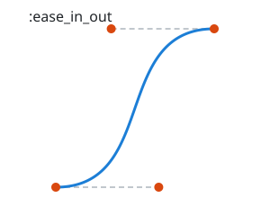 | 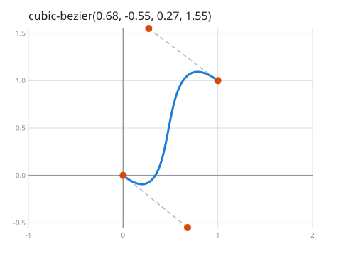 |

- **Good at:** easing. Animate anything from A to B with a natural feel.
- **Falls short:** it's only one bend. For a longer path, use a spline.
- **You've seen it in:** CSS's `transition-timing-function` (`ease`, `ease-in-out` and
  `cubic-bezier(...)` are all cubic Bezier curves), the pen tool in vector drawing apps like Illustrator,
  Figma and Inkscape, and font outlines (TrueType fonts use quadratic Beziers, OpenType CFF fonts cubic ones).

## Polyline

Straight lines from point to point.

```elixir
Curves.define_polyline([{0, 0}, {2, 3}, {4, 1}, {6, 4}, {8, 2}])
```

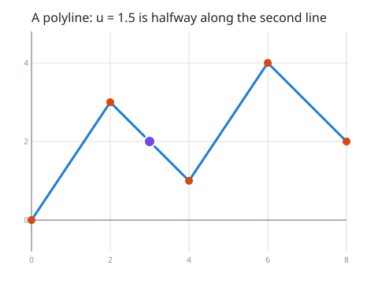

- **Good at:** being exact and honest. Every point is where you put it, and nothing is made up between them.
  It's also the cheapest.
- **Falls short:** sharp corners. Something moving along it turns instantly at each point.
- **You've seen it in:** SVG's `<polyline>`, GPS tracks (a run or a drive recorded as points joined by
  lines), plain line charts, and drawing apps that record your mouse or finger as a list of points.

## Bezier spline

A chain of Bezier curves, written like an SVG path: each knot, then the control points of the curve to the
next knot. Each piece can be a straight line (SVG `L`), a quadratic curve (`Q`) or a cubic curve (`C`).

```elixir
Curves.define_bezier_spline([
  [{0, 0}],                 # a straight line to {3, 2}
  [{3, 2}, {4.5, 5}],       # a quadratic curve to {6, 2}
  [{6, 2}, {7, 0}, {9, 5}], # a cubic curve to {10, 2}
  [{10, 2}]                 # the end
])
```

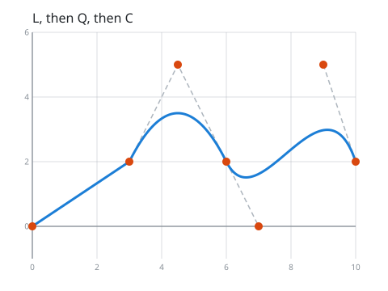

- **Good at:** total control, and talking to other tools. Anything drawn with SVG paths, a canvas or a
  vector drawing app can be copied in exactly.
- **Falls short:** you have to place every control point yourself. To keep the curve smooth through a
  knot, the control points either side of it must line up.
- **You've seen it in:** SVG's `<path>`, the HTML canvas's `bezierCurveTo` and `quadraticCurveTo`, and
  every letter of the font you're reading.

## Ellipses, circles and arcs

An exact ellipse or circle, or an arc of one: not built from Bezier curves, so it is perfectly round, and a
whole one ends exactly where it started. Give the centre and radii; `:rotation` tilts it, and `:from` and
`:to` (in degrees) cut out an arc. A bezier spline can also contain arcs, like SVG's `A` command.

```elixir
Curves.define_circle({0, 0}, 2, from: 90, to: 180)
Curves.define_bezier_spline([[{0, 0}], [{10, 0}, {:arc, 5, 5, 0, false, true}], [{10, 10}], [{0, 10}]])
```

| An arc of a circle | A path with an arc |
| --- | --- |
| 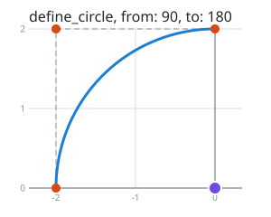 | 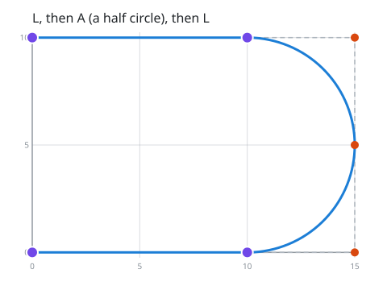 |

- **Good at:** anything round: wheels, dials, gauges, orbits, rounded corners, and anything that turns at
  a steady rate. On a circle, `u` moves at a steady speed.
- **Falls short:** on a long, thin ellipse the speed isn't steady: it goes faster round the long sides.
- **You've seen it in:** SVG's `<circle>`, `<ellipse>` and the path command `A`, the canvas's `arc()` and
  `ellipse()`, the `G2` and `G3` commands that move CNC machines and 3D printers in arcs, and every
  pie chart and progress ring.

## Hermite

A smooth curve through every knot, where you give each knot a tangent: the direction to travel and how fast.

```elixir
Curves.define_hermite([[{0, 0}, {4, 0}], [{4, 2}, {2, 0}], [{8, 0}, {4, 0}]])
```

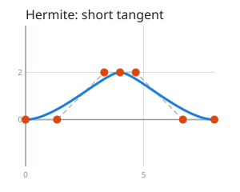

- **Good at:** motion where you know the speed and direction at each point, not just the position.
  Every other spline in this guide (except the B-spline) is a Hermite spline that works out the tangents
  for you.
- **Falls short:** you have to come up with every tangent.
- **You've seen it in:** animation keyframes with in and out tangents, such as Unity's `AnimationCurve`
  and the `CUBICSPLINE` animations in glTF 3D models, and robot or vehicle paths planned through
  waypoints with a known velocity at each.

## Catmull-Rom

Give it the knots, and it works out the tangents: at each knot, the curve heads in the direction from the
knot before it to the knot after it.

```elixir
Curves.define_catmull_rom([{0, 0}, {2, 3}, {4, 1}, {6, 4}, {8, 2}])
```

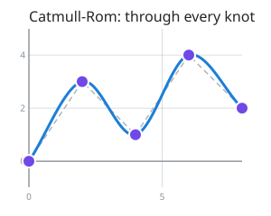

- **Good at:** the easiest smooth path through a list of points. Moving a knot only changes the curve
  near it.
- **Falls short:** when some knots are much closer together than others, it can overshoot, make sharp
  points, or loop (see centripetal below).
- **You've seen it in:** camera paths and patrol routes in games, the `Spline` curve in the Phaser game
  framework, and three.js's `CatmullRomCurve3` (as its `"catmullrom"` type).

## Cardinal

Catmull-Rom with a `:tension` slider. `0.0` is exactly Catmull-Rom; higher values pull the curve tighter
at each knot, until at `1.0` it's straight lines.

```elixir
Curves.define_cardinal([{0, 0}, {2, 3}, {4, 1}, {6, 4}, {8, 2}], tension: 0.5)
```

| `tension: -0.5` | `tension: 0.0` | `tension: 0.5` | `tension: 1.0` |
| --- | --- | --- | --- |
| 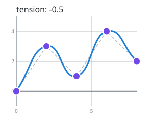 |  | 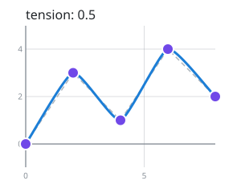 | 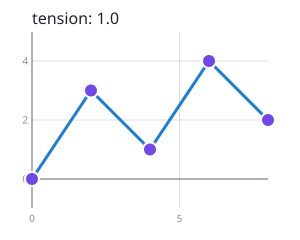 |

- **Good at:** letting a user (or a designer) choose how loose or tight a smooth line looks.
- **Falls short:** one tension for the whole curve, and it can still loop like Catmull-Rom.
- **You've seen it in:** d3's `curveCardinal`, the `tension` setting on lines in the Konva canvas
  library, and `DrawCurve` in Windows' GDI+ graphics, which draws cardinal splines.

## Centripetal Catmull-Rom

Catmull-Rom that takes the distances between knots into account. It's proven never to make loops or sharp
points (cusps) within a segment, and it hugs the knots more closely. If you want "a smooth line through
these points" and don't need anything else, this is the one to pick.

```elixir
Curves.define_centripetal_catmull_rom([{0, 0}, {10, 10}, {10.5, 10}, {20, 0}])
```

| Plain Catmull-Rom | Centripetal |
| --- | --- |
| 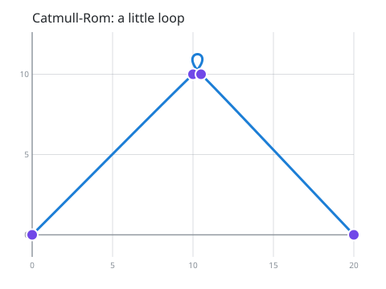 | 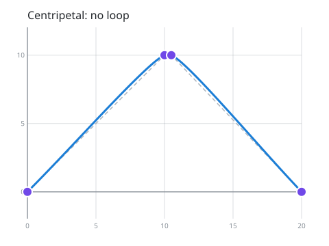 |

The `:alpha` option sets how much the distances count: `0.5` (the default) is centripetal, `0.0` is plain
Catmull-Rom and `1.0` is chordal.

- **Good at:** paths through points that a person clicked, recorded or digitised, where some points are
  bunched up and others are far apart.
- **Falls short:** because each segment still takes one unit of `u`, the speed can jump at a knot (the
  direction never does). To move at a steady speed, sample it with many points and walk along those.
- **You've seen it in:** d3's `curveCatmullRom` (whose default alpha is 0.5) and three.js's
  `CatmullRomCurve3` (whose default type is `"centripetal"`). It's the subject of the paper
  *Parameterization and applications of Catmull-Rom curves* (Yuksel, Schaefer and Keyser, 2011), which
  proved it never loops.

## Kochanek-Bartels (TCB)

Catmull-Rom with three dials. `:tension` works like the cardinal spline's. `:continuity` makes corners
(below 0) or bulges (above 0) at the knots. `:bias` makes the curve turn early (below 0) or late, swinging
past each knot (above 0). With all three at `0.0` it's exactly Catmull-Rom.

```elixir
Curves.define_kochanek_bartels([{0, 0}, {2, 3}, {4, 1}, {6, 4}, {8, 2}], bias: 0.7)
```

| `continuity: -0.7` | `continuity: 0.7` | `bias: -0.7` | `bias: 0.7` |
| --- | --- | --- | --- |
| 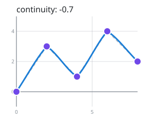 | 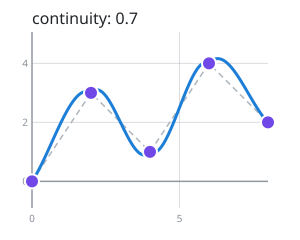 | 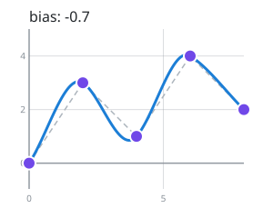 | 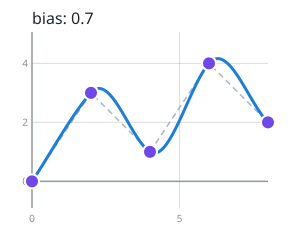 |

- **Good at:** keyframe animation with character. Bias gives a bouncing ball its overshoot, continuity
  gives a sharp change of direction, and tension makes a move snap into place.
- **Falls short:** three more numbers to tune. Here they apply to every knot, while animation tools
  usually let you set them per keyframe.
- **You've seen it in:** the TCB controllers of 3D Studio Max, and LightWave 3D's motion graphs. It comes
  from the 1984 paper *Interpolating splines with local tension, continuity, and bias control* by
  Kochanek and Bartels.

## Monotone

A smooth line through data points that never overshoots them. Between two points it only goes up, only
goes down, or stays flat, so a flat stretch of data stays flat, and the line never shows a peak or dip
that isn't in the data. Each point's `x` must be bigger than the one before.

```elixir
Curves.define_monotone([{0, 2}, {1, 2}, {2, 2}, {3, 8}, {4, 8.5}, {5, 3}, {6, 3}])
```

| Polyline | Catmull-Rom | Natural cubic | Monotone |
| --- | --- | --- | --- |
| 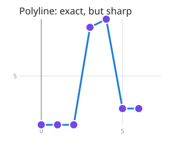 | 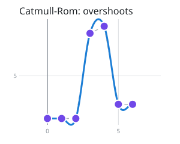 | 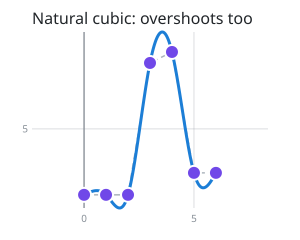 | 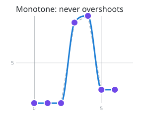 |

- **Good at:** charts. Prices, temperatures, counts: anything where a curve that dips below zero, or above
  the highest value, would be lying.
- **Falls short:** it only works on data, where `x` always goes one way. It can't draw a circle or a
  path that turns back.
- **You've seen it in:** smoothed line charts, such as Chart.js's `cubicInterpolationMode: 'monotone'`
  and d3's `curveMonotoneX`. Its relative, PCHIP, is a standard tool in MATLAB (`pchip`) and SciPy
  (`PchipInterpolator`). This one uses the Fritsch–Carlson method (1980).

## Natural cubic

The smoothest curve through every knot: not only its direction but also how sharply it bends changes
smoothly everywhere, and it straightens out at both ends.

```elixir
Curves.define_natural_cubic([{0, 0}, {2, 3}, {4, 1}, {6, 4}, {8, 2}])
```

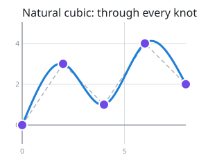

- **Good at:** fair, flowing shapes, and interpolating smooth measurements. It's what you get from bending
  a thin, springy strip through pins at the knots.
- **Falls short:** every knot affects the whole curve, so moving one point changes everything a little.
  It can overshoot, like Catmull-Rom.
- **You've seen it in:** the draftsman's spline, a flexible strip of wood bent around weights, used to
  draw ship hulls and aircraft before computers (and where the word "spline" comes from), d3's
  `curveNatural`, and SciPy's `CubicSpline(bc_type="natural")`.

## B-spline

The smoothest of all, but it doesn't go through your points: they pull it towards them, like magnets.

```elixir
Curves.define_b_spline([{0, 0}, {2, 3}, {4, 1}, {6, 4}, {8, 2}])
```

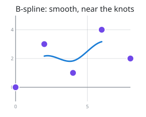

- **Good at:** smooth shapes you sculpt by moving points around, and smoothing out noisy points. It never
  goes outside the points that shape it.
- **Falls short:** it doesn't hit your points, and it only covers the middle: `n` points give `n - 3`
  segments.
- **You've seen it in:** CAD and 3D modelling, where NURBS (a more general form of B-spline) describe
  car bodies, aircraft parts and 3D-printed models, in tools like Rhino and Blender, and d3's `curveBasis`.
