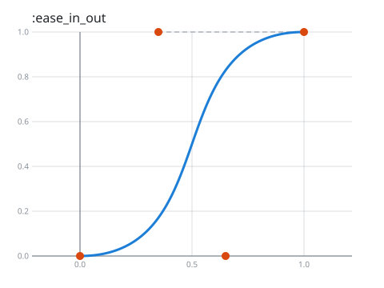
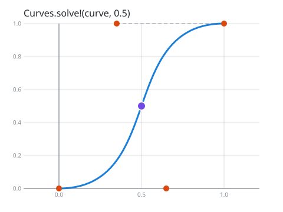
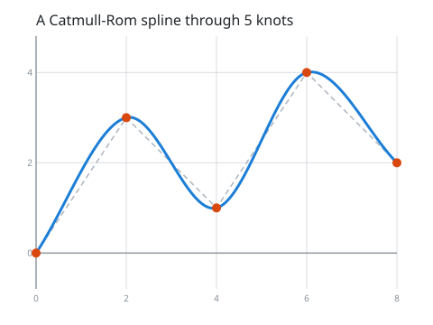

# Getting started

The `Curves` library finds points on smooth **Bezier Curves** and **Splines**. Give it a few points, and it
tells you where the curve goes between them. Use it for easing animations, drawing paths, moving things
along a route, or anything else that should bend smoothly instead of jumping in straight lines. (Actually that's a lie, you can use straight lines too.)

It is pure Elixir, with no dependencies, and fast: solving a point takes a fraction of a microsecond.

## Install

```elixir
def deps do
  [
    {:curves, "~> 1.0.0-rc.2"}
  ]
end
```

## Your first curve in three lines

```elixir
curve = Curves.define_bezier(:ease_in_out)
{x, y} = Curves.solve!(curve, 0.5)
Curves.Svg.save!(curve, "ease_in_out.svg")
```



The blue line is the curve. The orange dots are the points that shape it: the curve starts at the first,
ends at the last, and is pulled towards the ones in between.

## Finding a point: `t`

Every curve is travelled from start to end as `t` goes from `0.0` to `1.0`. Ask for any `t` in between,
and `Curves.solve!/2` tells you where you are:

```elixir
Curves.solve!(curve, 0.5)
#=> {0.5, 0.5}
```



## Longer paths: splines

A single Bezier curve has at most 4 points. For longer paths, a **spline** joins many curves into one.
This one passes through every point you give it:

```elixir
curve = Curves.define_catmull_rom([{0, 0}, {2, 3}, {4, 1}, {6, 4}, {8, 2}])
Curves.solve!(curve, 2.5)
```



## Where to next

The tutorial takes about 15 minutes and is full of pictures:

1. [Your first curve](tutorial/first_curve.md): `t`, `solve`, `take`, and the ready-made curves.
2. [Bezier curves](tutorial/bezier_curves.md): how control points shape a curve.
3. [Splines](tutorial/splines.md): polylines and the nine kinds of spline, and when to use each.
4. [Transforms and drawing](tutorial/transforms.md): moving, scaling and rotating curves, and drawing them.

Not sure which curve you need? [Choosing a curve](choosing_a_curve.md) compares them all, with real-world
examples of where each one is used.

Prefer to play? Each chapter is also an **interactive Livebook** with sliders and animations; look for the
"Run in Livebook" button on [the interactive version of chapter 1](livebooks/01_first_curve.livemd).

The full API is in the `Curves` module.
